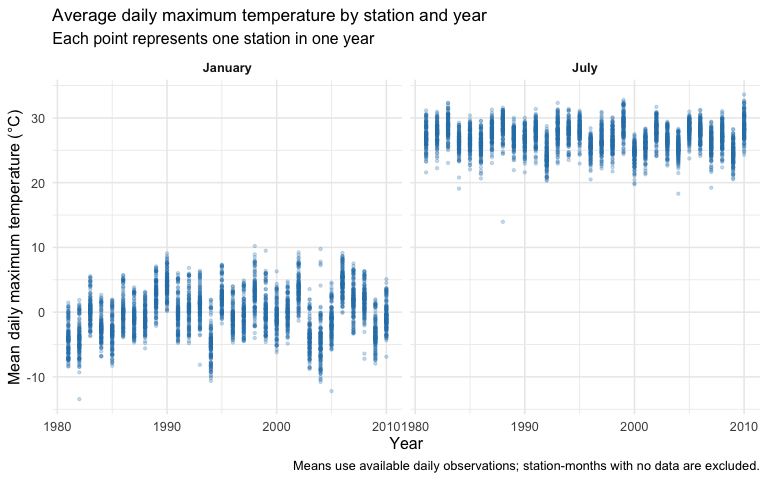
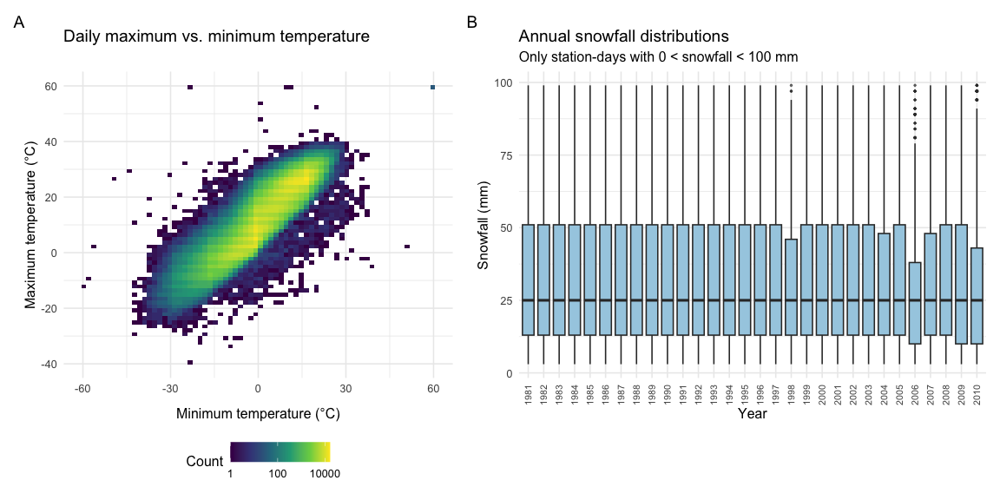

P8105 Homework 3
================
Xiaobo Shen

# Problem 1

``` r
data("ny_noaa")

glimpse(ny_noaa)
```

    ## Rows: 2,595,176
    ## Columns: 7
    ## $ id   <chr> "US1NYAB0001", "US1NYAB0001", "US1NYAB0001", "US1NYAB0001", "US1N…
    ## $ date <date> 2007-11-01, 2007-11-02, 2007-11-03, 2007-11-04, 2007-11-05, 2007…
    ## $ prcp <int> NA, NA, NA, NA, NA, NA, NA, NA, NA, NA, NA, NA, NA, NA, NA, NA, 3…
    ## $ snow <int> NA, NA, NA, NA, NA, NA, NA, NA, NA, NA, NA, NA, NA, NA, NA, NA, 3…
    ## $ snwd <int> NA, NA, NA, NA, NA, NA, NA, NA, NA, NA, NA, NA, NA, NA, NA, NA, 0…
    ## $ tmax <chr> NA, NA, NA, NA, NA, NA, NA, NA, NA, NA, NA, NA, NA, NA, NA, NA, N…
    ## $ tmin <chr> NA, NA, NA, NA, NA, NA, NA, NA, NA, NA, NA, NA, NA, NA, NA, NA, N…

``` r
ny_noaa |>
  summarize(
    observations = n(),
    stations = n_distinct(id),
    first_date = min(date),
    last_date = max(date)
  ) |>
  knitr::kable()
```

| observations | stations | first_date | last_date  |
|-------------:|---------:|:-----------|:-----------|
|      2595176 |      747 | 1981-01-01 | 2010-12-31 |

``` r
ny_noaa |>
  summarize(
    across(
      everything(),
      ~ mean(is.na(.x)) * 100
    )
  ) |>
  pivot_longer(
    everything(),
    names_to = "Variable",
    values_to = "Missing (%)"
  ) |>
  knitr::kable(digits = 2)
```

| Variable | Missing (%) |
|:---------|------------:|
| id       |        0.00 |
| date     |        0.00 |
| prcp     |        5.62 |
| snow     |       14.69 |
| snwd     |       22.80 |
| tmax     |       43.71 |
| tmin     |       43.71 |

This dataset contains 2595176 observations and 7 variables, representing
daily weather records from 747 stations in NY state between 1981-01-01
and 2010-12-31. Each row represents a station-day record.

Variables include station ID, date, precipitation, snowfall, snow depth,
and daily maximum and minimum temperatures.

Missingness varies substantially across variables. Precipitation is
missing in 5.62% of observations, snowfall in 14.69%, and snow depth in
22.80%. Both maximum and minimum temperatures are missing in
approximately 43.71% of observations. Temperature analyses therefore
rely on a substantially reduced subset of the records. Station ID and
date have no missing values.

## Data cleaning

``` r
noaa_clean =
  ny_noaa |>
  separate(
    date,
    into = c("year", "month", "day"),
    sep = "-",
    convert = TRUE,
    remove = FALSE
  ) |>
  mutate(
    tmax = as.numeric(tmax) / 10,
    tmin = as.numeric(tmin) / 10,
    prcp = prcp / 10
  )

noaa_clean |>
  filter(!is.na(snow)) |>
  count(snow, sort = TRUE) |>
  slice_head(n = 10) |>
  knitr::kable(
    col.names = c("snowfall (mm)", "number of observations")
  )
```

| snowfall (mm) | number of observations |
|--------------:|-----------------------:|
|             0 |                2008508 |
|            25 |                  31022 |
|            13 |                  23095 |
|            51 |                  18274 |
|            76 |                  10173 |
|             8 |                   9962 |
|             5 |                   9748 |
|            38 |                   9197 |
|             3 |                   8790 |
|           102 |                   6552 |

The date was separated into year, month, and day while retaining the
original date variable. Maximum and minimum temperatures were converted
to numeric values and expressed in degrees Celsius. Precipitation was
converted to millimeters; snowfall and snow depth were already recorded
in millimeters.

The most frequently observed snowfall value is 0 mm (2,008,508
observations), followed by 25 mm (31,022), 13 mm (23,095), and 51 mm
(18,274). Zero dominates because most station-days have no snowfall.
Common positive values such as 13, 25, 51, and 76 mm are approximately
equivalent to 0.5, 1, 2, and 3 inches, suggesting that the recorded
values reflect conversion and rounding from measurements in inches.##
Average maximum temperature in January and July

## average max temperature in January and July

``` r
noaa_monthly =
  noaa_clean |>
  filter(month %in% c(1, 7)) |>
  group_by(id, year, month) |>
  summarize(
    observed_days = sum(!is.na(tmax)),
    mean_tmax = mean(tmax, na.rm = TRUE),
    .groups = "drop"
  ) |>
  filter(observed_days > 0) |>
  mutate(
    month = factor(
      month,
      levels = c(1, 7),
      labels = c("January", "July")
    )
  )

ggplot(noaa_monthly, aes(x = year, y = mean_tmax)) +
  geom_point(alpha = 0.25, size = 0.8, color = "#2C7FB8") +
  facet_wrap(~ month, nrow = 1) +
  labs(
    title = "Average daily maximum temperature by station and year",
    subtitle = "Each point represents one station in one year",
    x = "Year",
    y = "Mean daily maximum temperature (°C)",
    caption = "Means use available daily observations; station-months with no data are excluded."
  ) +
  theme(
    plot.title = element_text(size = 13),
    strip.text = element_text(face = "bold")
  )
```

<!-- -->
July has much higher average daily maximum temperatures than January.
Most station-level averages fall around 20–33°C in July and −10–10°C in
January. Temperatures vary across stations, and many stations show
similar year-to-year fluctuations, suggesting shared regional weather
patterns. January shows more pronounced interannual variation than July.

There are several unusually low station-level averages, including a July
value near 14°C around 1988. These observations warrant checking the
underlying daily records and the number of observed days. Because
monthly means use available observations, incomplete coverage may affect
their comparability. The figure alone does not establish a clear
long-term trend.

## Temperature relationship and snowfall distributions

``` r
temperature_plot =
  noaa_clean |>
  filter(!is.na(tmin), !is.na(tmax)) |>
  ggplot(aes(x = tmin, y = tmax)) +
  geom_bin_2d(bins = 70) +
  scale_fill_viridis_c(
    trans = "log10",
    name = "Count"
  ) +
  labs(
    title = "Daily maximum vs. minimum temperature",
    x = "Minimum temperature (°C)",
    y = "Maximum temperature (°C)"
  ) +
  theme(legend.position = "bottom")

snowfall_plot =
  noaa_clean |>
  filter(snow > 0, snow < 100) |>
  ggplot(aes(x = factor(year), y = snow)) +
  geom_boxplot(
    fill = "#A6CEE3",
    outlier.alpha = 0.2,
    outlier.size = 0.5
  ) +
  labs(
    title = "Annual snowfall distributions",
    subtitle = "Only station-days with 0 < snowfall < 100 mm",
    x = "Year",
    y = "Snowfall (mm)"
  ) +
  theme(
    axis.text.x = element_text(
      angle = 90,
      hjust = 1,
      vjust = 0.5,
      size = 8
    )
  )

(temperature_plot + snowfall_plot) +
  plot_layout(widths = c(1, 1.2)) +
  plot_annotation(tag_levels = "A")
```

<!-- -->

Daily maximum and minimum temperatures show a strong positive
association: days with higher minimum temperatures generally also have
higher maximum temperatures.

Most observations lie within a concentrated diagonal band. A few
isolated records have extreme temperatures or maximum temperatures below
minimum temperatures; these warrant further investigation rather than
automatic removal.

Among station-days with snowfall greater than 0 and less than 100 mm,
the annual distributions are broadly similar. Median snowfall is
approximately 25 mm across years, and the middle 50% of observations
generally spans about 13–51 mm. Some years, such as 2006 and 2010, have
lower upper quartiles. These conditional distributions do not describe
annual total snowfall or the frequency of snowfall days.

# Problem 2

# Problem 3
